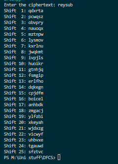

#Sample input: reysub
#sample output: 

#Shift  1: qdxrta
#Shift  2: pcwqsz
#Shift  3: obvpry
#Shift  4: nauoqx
#Shift  5: mztnpw
#Shift  6: lysmov
#Shift  7: kxrlnu
#Shift  8: jwqkmt
#Shift  9: ivpjls
#Shift 10: huoikr
#Shift 11: gtnhjq
#Shift 12: fsmgip
#Shift 13: erlfho
#Shift 14: dqkegn
#Shift 15: cpjdfm
#Shift 16: boicel
#Shift 17: anhbdk
#Shift 18: zmgacj
#Shift 19: ylfzbi
#Shift 20: xkeyah
#Shift 21: wjdxzg
#Shift 22: vicwyf
#Shift 23: uhbvxe
#Shift 24: tgauwd
#Shift 25: sfztvc 

#why 23 tries is not security?
#Caesar cipher is a very simple encryption method. It only has 25 possible shifts (since shifting by 26 would return the original text). An attacker can easily try all possible shifts (from 1 to 25) to decrypt the message, which is known as a brute-force attack.   